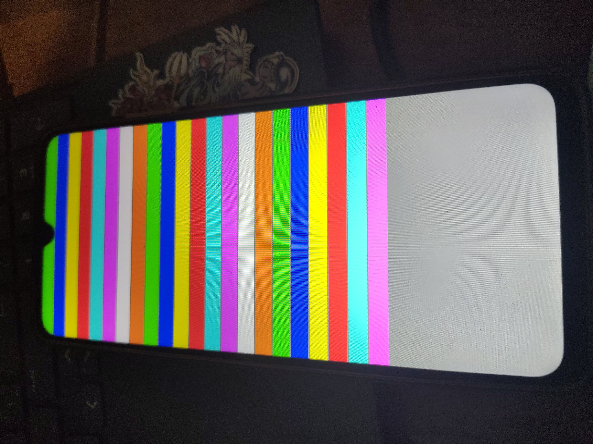
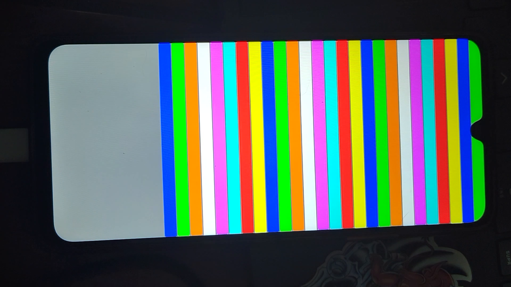

# 14 — The Zircon kernel runs on the Moto G06; kernel progress bar

## Where we are (attempt 12, 2026-10-28 10:54)

The screen turned **GRAY**: the Zircon kernel proper is executing on the MT6768, painted from
`lk_main` through the kernel physmap. The full chain that got us here:

| fix | doc |
|---|---|
| LK gunzips the boot kernel, so ship it gzipped | [11](11-root-cause-lk-gunzip.md) |
| disable the TOPRGU watchdog as the shim's first instruction | [10](10-attempt3-mediatek-watchdog.md) |
| feed the shim a clean minimal DTB, copied **out of** the image | [13](13-attempt10-blue-shim-works.md) |
| no `stdout-path` (null console) until we have a UART tap | [13](13-attempt10-blue-shim-works.md) |
| embed the ZBI as a cpio member named `zbi` | [13](13-attempt10-blue-shim-works.md) |

No panic-reboot followed in 3 minutes, but GRAY alone can't tell "kernel healthy" from
"kernel hung after `lk_main`'s first lines".

## Attempt 13: a progress bar inside the kernel

Painting late in boot needs the framebuffer pages to stay ours. Physboot now retypes the
framebuffer bank as `kTestRamReserve` right after `InitMemory`. The kernel PMM puts that
type on its permanently-reserved list, but it is still RAM, so the physmap keeps covering it.

Kernel stages paint horizontal **bands** from the top, 160 rows each, on top of the GRAY
background. Count the bands:

| band | colour | where in `zircon/kernel/top/main.cc` | proves |
|---|---|---|---|
| (background) | GRAY | `lk_main` after `PostHandoffBootstrap` | kernel entered |
| 1 | GREEN | top of `bootstrap2` | threads + scheduler run |
| 2 | BLUE | after `platform_init` / `LK_INIT_LEVEL_ARCH_LATE-1` | arch + platform init (GIC, timer, PSCI from the ZBI driver items) |
| 3 | YELLOW | before `userboot_init` | late per-CPU init done; starting userspace |
| 4 | MAGENTA | after `userboot_init` | userboot launched: **Zircon reached userspace** |
| bottom strip | blinks WHITE/BLACK every 500 ms | `lagos-heartbeat` thread, started after band 2 | scheduler + arch timer + GIC interrupts work |

A blinking strip is the strongest single signal: it needs timer interrupts delivered
through the GIC and the scheduler waking a sleeping thread.

## Attempt 13 RESULT (verified flash 11:00:27): GRAY, **no bands**

The screen went through the shim/physboot colours to GRAY and stayed there; no band, no
blinking strip. USB stayed quiet for 3 minutes (no panic-reboot). So the kernel enters
`lk_main` but never reaches the top of `bootstrap2`: it hangs somewhere inside `lk_main`'s
early init.

## Attempt 14: bisect `lk_main` with 20 numbered steps

`LagosStep(k)` paints a 60-row band at row `(k-1)*64` (4-row black gap between bands).
Colours cycle **green, blue, yellow, red, cyan, magenta, white, orange**, so the band count
plus the last colour identifies the step.

| step | after… |
|---|---|
| 1 | `thread_init_early`, `dlog_init_early`, `CallConstructors` |
| 2 | init level EARLIEST → ARCH_EARLY-1 |
| 3 | `arch_early_init` |
| 4 | init level ARCH_EARLY → PLATFORM_EARLY-1 |
| 5 | `platform_early_init` (ZBI driver items: GIC, timer, PSCI, UART…) |
| 6 | `DriverHandoffEarly` |
| 7 | init level PLATFORM_EARLY → ARCH_PREVM-1 |
| 8 | `arch_prevm_init` + its init level |
| 9 | `platform_prevm_init` + its init level |
| 10 | `vm_init_preheap` + level |
| 11 | `heap_init` + level |
| 12 | `vm_init` + level |
| 13 | `DriverHandoffPostVm` + INTC level |
| 14 | lockup detector, sampler, `topology_init` + level |
| 15 | `kernel_init` + level |
| 16 | `bootstrap2` thread created and resumed (next: `BecomeIdle`) |
| 17 | top of `bootstrap2` (scheduler switched threads) |
| 18 | `arch_init` + `platform_init` + `DriverHandoffLate` done; heartbeat starts |
| 19 | late per-CPU init done, starting userboot |
| 20 | `userboot_init` returned: userspace launched |

Bottom strip (rows 1440–1640) blinks white/black every 500 ms once step 18 is reached.

## Attempt 14 RESULT (verified flash 11:09:35): "5 bands", rest of the screen gray

> **Re-read after attempt 15:** the user listed the colours as green, blue, yellow, red, then
> gray. That is **4** bands (steps 1–4) plus the gray background; step 5 would have been
> cyan. The analysis below (hang in `DriverHandoffEarly`) was one step too late. See
> attempt 15's result.

Steps 1–5 ran: constructors, the EARLIEST and ARCH_EARLY init levels, `arch_early_init`
and **`platform_early_init`**. Step 6 (after `DriverHandoffEarly`) never painted. USB stayed
quiet (no reset). So the kernel hangs (or panics silently, before PSCI is up) inside
`DriverHandoffEarly`, which runs, in order:

1. `UartDriverHandoffEarly` (null console here)
2. `ArmGicInitEarly` → `rust_arm_gicv3_init_early`: only stores the GIC addresses;
   can only fail on `assert!(config.mmio_phys != 0)`
3. `generic_32bit_watchdog_early_init` (skipped: no watchdog node in `lagos-min.dts`)
4. `ArmGenericTimerInit` → `arm_generic_timer_init` (picks virt/phys timer from the ZBI
   IRQs; panics if none; hard-stops if CNTFRQ is 0)
5. `PsciInit` (first SMC calls into MediaTek's ATF)

## Attempt 15: bisect `DriverHandoffEarly`

New steps 6–10 sit inside it (`dev/init.cc`, `platform/generic-arm/dev-init.cc`), through
an external `LagosKernelStep()` wrapper. Old steps 6–20 shift to 11–25. Bands are now 52
rows on a 56-row stride so 25 steps fit above the heartbeat strip.

| step | after… |
|---|---|
| 1–5 | as attempt 14 (5 = `platform_early_init`) |
| 6 | UART handoff (null console) |
| 7 | GIC early init |
| 8 | watchdog early init (absent) |
| 9 | ARM generic timer init |
| 10 | PSCI init |
| 11–25 | old steps 6–20 (11 = `DriverHandoffEarly` returned … 22 = top of `bootstrap2` … 25 = userspace) |

Colour cycle unchanged: green, blue, yellow, red, cyan, magenta, white, orange. Verified in
the binary: the inlined paints start at rows 280, 336, 392, 448, 504 (steps 6–10).

## Attempt 15 RESULT (verified flash 11:18:49): green, blue, yellow, red, then gray

Same as attempt 14, and now the colours are explicit: **4 bands**. Step 5 (cyan, after
`platform_early_init`) never painted. The hang is inside `platform_early_init`, which on
generic-arm does: persistent RAM (none), `pmm_checker_init_from_cmdline()`,
`ASSERT(pmm_init(memory) == ZX_OK)`, `arm64_mmu_early_init()`.

### Root cause: our own framebuffer reservation starved a PMM arena

Attempt 13 made physboot retype the **whole** framebuffer bank `[0x781b0000, +0x1050000)` as
`kTestRamReserve`. The gap below that bank (~725 MB) is far beyond what the PMM will bridge,
so the bank is its own arena. Every arena needs free RAM **inside itself** for its page
bookkeeping (48 bytes per page, about 200 KiB for this bank). With the whole bank
reserved there was none, so `SelectPmmArenas()` reported `kNoBookkeepingSpace` for an
*allocated* range, and `PmmNode::Init` fails hard:

```
// If we fail to include a pre-PMM allocation in an arena that could be
// disastrous in unpredictable/hard-to-debug ways, so fail hard early.
ZX_ASSERT(!allocation_excluded);
```

PSCI isn't initialized yet and there's no console, so the panic just spins. GRAY with four bands.

Attempt 12 (GRAY, before the reservation existed) had no bands, so it could not tell us
where it stopped; it may have hung somewhere else entirely. Attempt 16 will show.

## Attempt 16: reserve only the painted frames

Physboot now reserves `[0x781b0000, +0xE04000)`, exactly the three frames we paint. The free
`0x24C000` tail (2.3 MB) holds the arena's bookkeeping. Verified in the binary: physboot no
longer references `0x1050000`. The step legend is unchanged from attempt 15:

| bands | stuck in / reached |
|---|---|
| 4 (green, blue, yellow, red) | `platform_early_init` again → the PMM is still unhappy |
| 5–10 | `DriverHandoffEarly`: 5 → UART handoff, 6 → GIC, 7–8 → timer, 9 → PSCI |
| 11–21 | rest of `lk_main` (VM, heap, topology, `kernel_init`) |
| 22+ | `bootstrap2` running; 23 + **blinking bottom strip** = timers + interrupts work; 25 = userspace |

## Attempt 16 RESULT (verified flash): **22 bands** 🎉



(Phone photographed sideways: the top of the screen is on the left.) Reading the bands:
green, blue, yellow, red, cyan, magenta, white, orange, twice over, then green, blue,
yellow, red, cyan, magenta. That is steps 1 to 22, then the gray background.

So the PMM fix was right, and in one flash the kernel got through **all of `lk_main`**:
PMM, `DriverHandoffEarly` (GIC, timer, PSCI), the pre-VM hooks, VM, heap,
`DriverHandoffPostVm`, lockup detector, topology, `kernel_init`. It created `bootstrap2`, and
the **scheduler switched to it** (step 22). It stops before step 23 (the old "after
`platform_init`"). No blinking strip, because the heartbeat starts after that point.

### Suspect: wrong CPU IDs in our minimal device tree

`bootstrap2` runs `arch_init` and `platform_init`, and the latter starts the secondary CPUs
(`topology_cpu_init` → PSCI `CPU_ON`). Our `lagos-min.dts` gave the 8 cores
`reg = 0x000-0x003, 0x100-0x103`. Motorola's DTB says MT6768 is **DynamIQ**: MPIDR Aff1 is
the core index and Aff0 is 0, so the IDs are `0x000, 0x100, … 0x700`, in two clusters
(6× Cortex-A55, 2× Cortex-A75). PSCI `CPU_ON` for "0x001" targets a core that does not
exist.

## Attempt 17: real MPIDRs + cpu-map, and finer `bootstrap2` steps

- `lagos-min.dts`: `reg = <0x000> … <0x700>`, plus a `cpu-map` with cluster0 (cpu0–5) and
  cluster1 (cpu6–7), copied from the stock DTB.
- `bootstrap2` gets steps 23–27; old 23–25 become 28–30. Bands are now 44 rows on a 48-row
  stride, so 30 fit above the heartbeat strip.

| step | after… |
|---|---|
| 22 | top of `bootstrap2` |
| 23 | THREADING → ARCH-1 init hooks |
| 24 | `arch_init` |
| 25 | ARCH → PLATFORM-1 init hooks |
| 26 | `platform_init` (secondary CPUs started here) |
| 27 | `DriverHandoffLate` |
| 28 | PLATFORM → ARCH_LATE-1 hooks; **heartbeat strip starts blinking** |
| 29 | late per-CPU init done, starting userboot |
| 30 | `userboot_init` returned: **userspace** |

### Build gotcha: the compile cache ignores `.incbin` contents

The first attempt-17 build produced a shim that still carried the *old* 1886-byte DTB,
although the object file's timestamp changed. The compile cache keys on the preprocessed
source, and the bytes `.incbin` reads aren't part of it. Fix: give each DTB revision a new
file name (`lagos-min-v3.dtb`) so the source text changes. Always verify the embedded FDT
(`totalsize`, a node name such as `cpu@700`) in the built shim before flashing.

## Attempt 17 RESULT (verified flash 11:39:08): **26 bands, then a reboot loop**



(Video frame, phone sideways: the top of the screen is on the **right**.) The video shows
the whole chain in order: BLUE/MAGENTA (shim) → ORANGE/WHITE (physboot) → GRAY + bands
(kernel) → black (reset). The last bright frame has 26 bands: three full colour cycles,
then green, blue.

- **The MPIDR fix worked.** Step 26 is after `platform_init`, which starts the secondary
  CPUs.
- Step 27 (`DriverHandoffLate`) never paints. The phone resets about 11 s after LK hands
  off, and the USB log shows a preloader pass every ~16 s.
- This is the first **fast** reset loop. The kernel panics, and PSCI now works (step 10
  onward), so Zircon's default panic action, `power_reboot(REBOOT_PANIC)` → PSCI
  `SYSTEM_RESET`, actually reboots the board. Earlier panics happened before PSCI was up,
  so they just spun.

Nothing in `UartDriverHandoffLate`/`PlatformDriverHandoffLate` stands out as panicky
here (null UART, GIC deny-list, no MMIO timer/SMMU/RNG items), and a secondary CPU that just
came up could be the one panicking. Bisecting further with colours costs a flash per step.
So the next step is to read the panic itself. Continued in [15](15-framebuffer-console.md).
