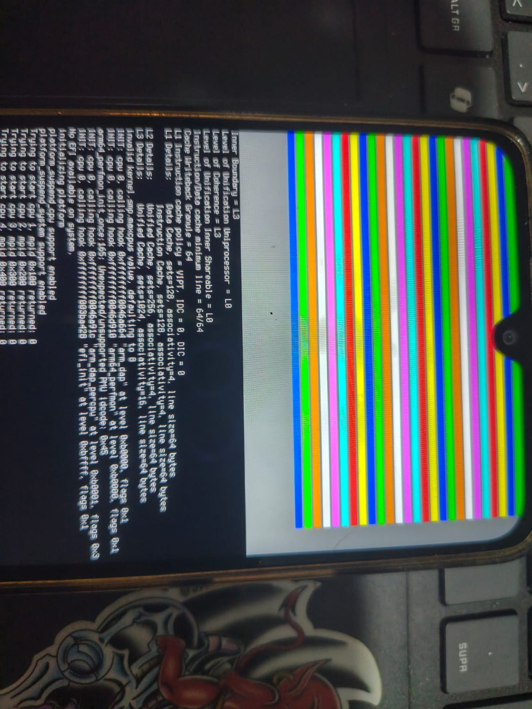
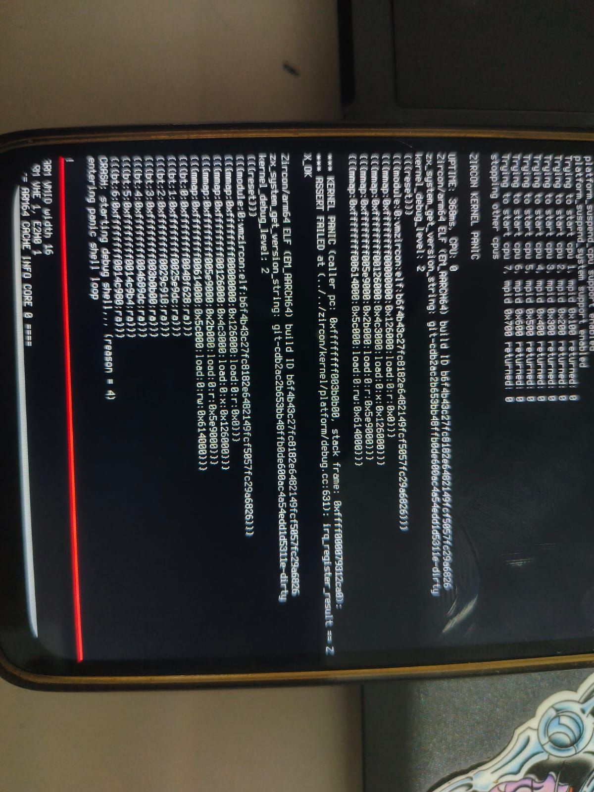
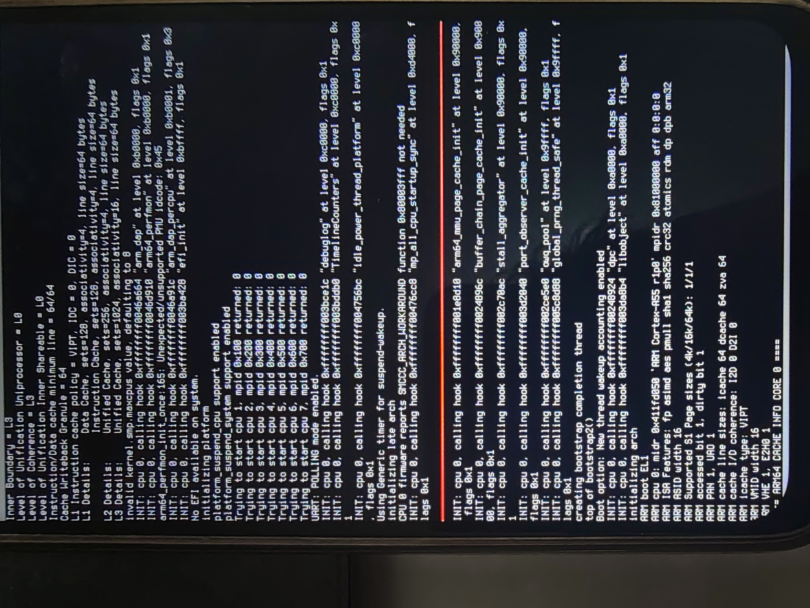
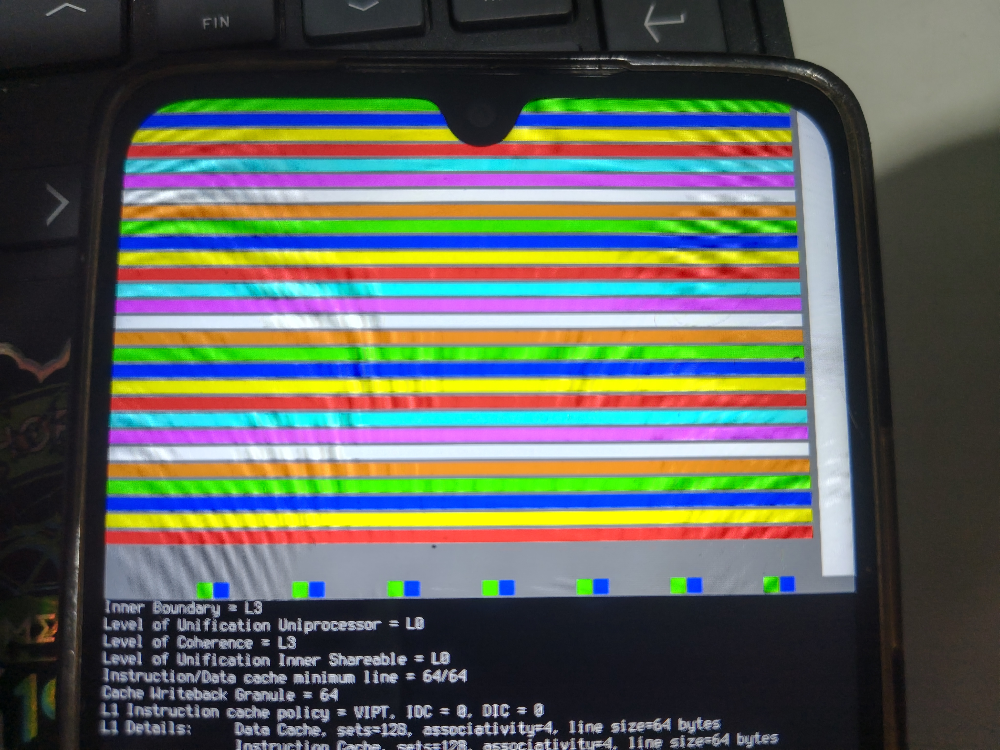
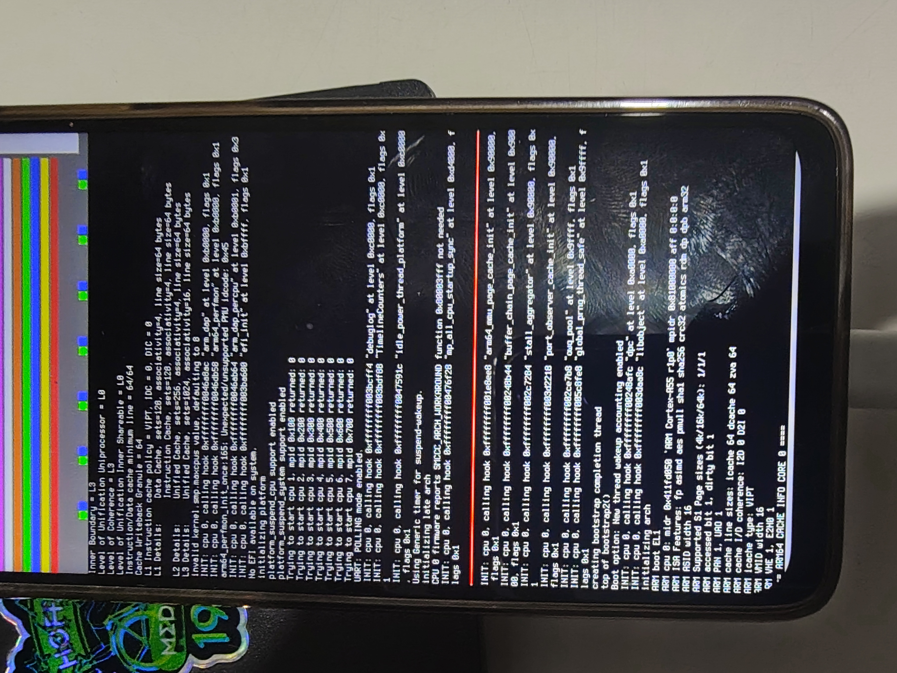

# 15 — A framebuffer text console for Zircon

With the kernel running through `bootstrap2` and panicking somewhere after the secondary
CPUs start, colour bands have reached their limit. We need the panic message, and we still
have no UART tap. So attempt 18 draws the kernel's console output **as text** into LK's
framebuffer.

## How it works

- **Hook:** `zircon/kernel/platform/debug.cc`. `platform_dputs_thread`,
  `platform_dputs_irq` and `platform_pputc` (all serial-console output, including panics)
  first call `LagosConsoleWrite()`. This runs before the null-UART early return, so it
  works with no serial driver.
- **Getting `printf` there:** with the null UART the debuglog's dumper thread is never
  started, so normal `printf` output would only land in the in-memory log. The DTB now sets
  `chosen/bootargs = "kernel.bypass-debuglog=true kernel.halt-on-panic=true"`.
  `bypass-debuglog` sends every line synchronously through `serial_write` →
  `platform_dputs_irq`. `halt-on-panic` keeps the panic on screen instead of rebooting.
- **Font:** `zircon/kernel/platform/lagos_font8x16.h`, printable ASCII generated from
  the host's `Lat2-Terminus16.psfu.gz` (Terminus, SIL OFL 1.1), using the PSF2 Unicode
  table to map code points to glyphs.
- **Region:** rows 496–1632, 71 lines × 90 columns, light gray on black, drawn into all
  three frame slots and cleaned from the cache per line. It **wraps** instead of
  scrolling, which is cheap and safe in panic context. A **red bar** marks the line after
  the newest one, so the text just above the red bar is the most recent.
- **Exclusion:** a best-effort atomic flag between CPUs, bounded so a panic never deadlocks
  on it.

## Screen layout (attempt 18)

| area | content |
|---|---|
| rows 0–480, cols 0–680 | progress bands, now 12 rows each on a 16-row stride (same step numbers and colours) |
| rows 0–480, cols 688–720 | heartbeat strip, blinks white/black every 500 ms after step 28 |
| rows 496–1632 | **text console** |

## Two latent bugs fixed on the way

- `gPhysHandoff` is set to `nullptr` by `EndHandoff()` (`top/handoff.cc`), so the old band
  helper would silently have stopped painting before steps 29–30. All kernel-side painting
  now uses `gPhysmapBase`/`gPhysmapSize` from `vm/physmap.h`, which persist.
- Device-tree revisions must change file name: `lagos-min-v4.dtb` (see the cache gotcha in
  [14](14-zircon-kernel-runs.md)). Verified in the built shim: 2407-byte FDT with the
  `bootargs` and `cpu@700`.

## What to send back

A **photo of the whole screen** after it stops changing. The text near the red bar is what
we need; a panic will show `ZIRCON KERNEL PANIC` and a backtrace.

## Attempt 18 RESULT (verified flash 11:48:07): **the console works, and shows the panic**




The halt-on-panic option kept the message on screen, and USB stayed quiet: no more reboot
loop. Highlights from the log:

```
Trying to start cpu 1, mpid 0x100 returned: 0     ... through cpu 7, mpid 0x700: 0
arm64_perfmon_init_once:165: Unexpected/unsupported PMU idcode: 0x45
No EFI available on system.
invalid kernel.smp.maxcpus value, defaulting to 8
...
ZIRCON KERNEL PANIC
UPTIME: 368ms, CPU: 0
*** KERNEL PANIC (caller pc: 0xffffffff003b0b00, stack frame: 0xffffff000079312c0):
*** ASSERT FAILED at (../../zircon/kernel/platform/debug.cc:631): irq_register_result == ZX_OK
kernel_debug_level: 2
CRASH: starting debug shell... (reason = 4)
entering panic shell loop
```

- **All 7 secondary CPUs start** through PSCI with the corrected DynamIQ MPIDRs.
- The panic is in `UartDriverHandoffLate` (upstream `debug.cc:631`): registering the UART
  interrupt handler fails. Even without `stdout-path`, the shim hands the kernel the real
  dw8250 UART at `0x11002000`; it is not the null driver. Our minimal UART node had **no
  `interrupts` property**, so the IRQ number was invalid and
  `register_permanent_int_handler()` failed.
- This also means the kernel has been writing its console to the real UART all along.
  It works fine for TX (no hangs), so a physical tap at `0x11002000` would show the log.

## Attempt 19: UART interrupt + polling

- `lagos-min.dts` UART node: `interrupts = <0 0x70 4>`, copied from the stock `apuart0`
  (SPI 0x70, level-high).
- `bootargs += kernel.debug_uart_poll=true` (note the underscores). The kernel polls the
  UART from a timer instead of registering the IRQ. That sidesteps an untested question:
  MediaTek routes SPI polarity through its `sysirq`/intpol block, which nothing here
  programs.
- DTB file `lagos-min-v5.dtb`; verified in the shim (2459-byte FDT, poll option present).

## Attempt 19 RESULT (verified flash): past the UART; hangs waiting for the secondaries



`UART: POLLING mode enabled.` The UART panic is gone. Boot continues through the debuglog
hook, `idle_power_thread_platform`, `Using Generic timer for suspend-wakeup`,
`initializing late arch` and `SMCCC_ARCH_WORKAROUND ... not needed`. The newest line, just
above the red bar, is:

```
INIT: cpu 0, calling hook 0xffffffff00476cc8 "mp_all_cpu_startup_sync" at level 0xd4000, flags 0x1
```

That hook waits for every CPU to check in, with a **30 s** timeout. On this debug kernel
(`kernel_debug_level: 2`) a timeout prints an oops and boot continues. Two facts:

- None of the 7 secondaries ever printed anything (`arm64_feature_debug` prints
  `ARM cpu N: midr …` for the first core of each cluster). PSCI `CPU_ON` returned 0 for all
  of them, so they were powered and started somewhere, then died before that print.
- If the screen stays frozen on that line past 30 s, the boot CPU's **timer interrupt**
  isn't waking it either.

Also from the boot CPU: `ARM boot EL1`, `ARM cpu 0: midr 0x411fd050 'ARM Cortex-A55 r1p0'
mpidr 0x81000000`, `VHE 1, E2H0 1`.

## Attempt 20: per-core markers + timer heartbeat on the console

**Per-core squares**: row 480 (between the bands and the console), 14×14 px, column
`core*90 + stage*16`, core = MPIDR.Aff1. Core 0's slot stays empty; it's the boot CPU.

| stage | painted from | colour | meaning |
|---|---|---|---|
| 0 | `secondary.S`, first instructions, MMU off | **GREEN** = arrived at EL1, **MAGENTA** = EL2, RED = other | PSCI really entered our code |
| 1 | `secondary.S`, after `ArmDropToEl1`, MMU off | BLUE | EL drop OK |
| 2 | `arm64_secondary_entry` (C, MMU on) | YELLOW | MMU enable + jump to the kernel's virtual address OK |
| 3 | after `arch_mp_init_percpu` | WHITE | per-CPU GIC/IRQ init OK |
| 4 | `lk_secondary_cpu_entry` after `arch_late_init_percpu` | ORANGE | fully up |

Stages 0–1 are written in assembly as physical stores (MMU off → Device memory → straight
to DRAM), touching only x10–x17 so the PSCI context in x0 survives.

**Heartbeat on the console**: every 10 s the heartbeat thread prints
`lagos: heartbeat N s, online cpus mask 0x…`. If those lines appear, timers and the
scheduler work on CPU 0, and the mask shows which cores are online.

## Attempt 20 RESULT: every secondary stops after the EL drop; CPU 0 gets no timer IRQ




- **Per-core squares**: cores 1–7 each show **GREEN, BLUE** and nothing more. They enter
  our code from PSCI **at EL1** and survive `ArmDropToEl1`, then die before
  `arm64_secondary_entry`'s first line. That stretch: `vbar_el1 = 0`, caches on, load the
  page-table globals, TLB invalidate, MAIR/TCR/TTBR, MMU on, `br` to the kernel vaddr, set
  `tpidr_el1` and **`sp` from `x0`** (the PSCI `context_id`), `bl arm64_secondary_entry`.
  With `vbar_el1 = 0` any fault there jumps to address 0 and hangs silently.
- **28 bands**: step 28 (heartbeat thread created) was reached, but no
  `lagos: heartbeat` line ever printed after 40+ s, and the 30 s SMP timeout never fired.
  **CPU 0's timer interrupt never arrives.**

## Attempt 21: x0 fallback, finer secondary stages, polled SMP wait + timer/GIC dump

**Hypothesis for the secondaries:** MediaTek's PSCI path doesn't deliver `context_id` in
`x0`. Linux never relies on it; its secondary entry finds its data by MPIDR. Zircon uses it
as the new core's stack.

- `platform_start_cpu()` also stores each core's context in
  `gLagosSecondaryContext[MPIDR.Aff1]`, cleaned to PoC.
- `arm64_secondary_start` checks `x0`: if bits 63:48 aren't all ones (not a kernel
  address), it reloads `x0` from that table (`adr_global`, MMU off).

Per-core squares are now 10×10 on a 12-px stride:

| stage | colour | meaning |
|---|---|---|
| 0 | GREEN/MAGENTA/RED | entered at EL1 / EL2 / other |
| 1 | **CYAN** = x0 was a kernel pointer · **RED** = x0 was junk, recovered from the table | |
| 2 | BLUE | after `ArmDropToEl1` |
| 3 | YELLOW | MMU on, running at the kernel vaddr (painted through the TTBR0 identity map, rows cleaned with `dc civac`) |
| 4 | WHITE | `arm64_secondary_entry` (C) |
| 5 | ORANGE | after `arch_mp_init_percpu` |
| 6 | GREEN | after `arch_late_init_percpu` |

**CPU 0 timer:** `mp_all_cpu_startup_sync` now **polls** the ready mask against the counter
for 15 s instead of sleeping on an event, so boot continues even without timer IRQs. It
prints `lagos[smp-wait]` and `lagos[+3s]` diagnostics:

- system registers: `CurrentEL`, `DAIF`, `ISR_EL1`, `CNTFRQ`, `CNTVCT`/`CNTV_CTL`/`CNTV_CVAL`,
  `CNTPCT`/`CNTP_CTL`, `ICC_SRE`/`IGRPEN1`/`PMR`/`CTLR`/`HPPIR1`/`RPR`
- GICD `CTLR`/`TYPER`/`IIDR`, and the GICR frame of CPU 0 (`CTLR`, `TYPER`, `WAKER`,
  `IGROUPR0`, `ISENABLER0`, `ISPENDR0`, `ISACTIVER0`, `ICFGR1`, `IGRPMODR0`, `IPRIORITYR6`)
  mapped with `VmAspace::AllocPhysical`

Then `lagos: smp wait done after N ms, ready … online …`, then the stock oops if cores are
missing.
